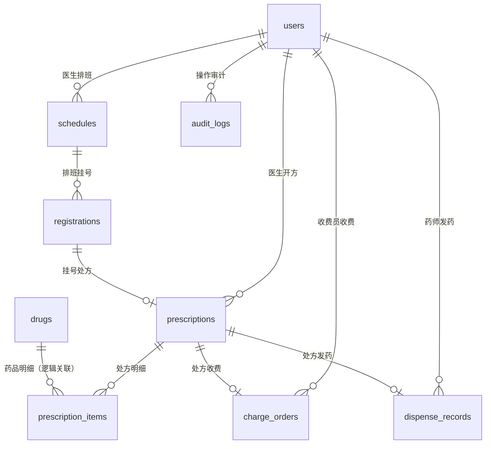

# 小型门诊医院信息管理系统 数据库设计文档

| 项目 | 内容 |
|---|---|
| 项目名称 | 小型门诊医院信息管理系统 |
| 文档名称 | 数据库设计文档 |
| 文档版本 | v1.0 |
| 编制日期 | 2026-10-27 |
| 数据库类型 | SQLite |
| ORM 框架 | SQLAlchemy |
| 依据 | 现有 `backend/app/models/` 全部模型代码、项目需求规格说明书、AGENTS.md |
| 数据表数量 | 9 张 |

---

## 1. 数据库概述

### 1.1 数据库定位

本项目采用 SQLite 单文件数据库，适合小型门诊课程设计和轻量部署。开发环境使用项目根目录数据库文件，Docker 部署环境将 SQLite 文件挂载到持久化数据目录。

### 1.2 设计原则

1. 所有业务表使用整型主键 `id`。
2. 金额统一使用 `NUMERIC` 类型，业务层使用 `Decimal` 计算。
3. 枚举值以字符串形式存储，便于 SQLite 兼容和课程演示。
4. 关键业务字段增加非空、唯一、检查约束。
5. 挂号、收费、发药等关键操作通过事务保证一致性。
6. 审计日志只追加写入，不提供业务修改和删除入口。
7. 处方明细的 `drug_id` 为逻辑关联字段，当前未建立数据库外键，收费和发药时由业务层校验药品档案。

### 1.3 数据表清单

| 序号 | 表名 | 中文名称 | 主要用途 |
|---|---|---|---|
| 1 | users | 用户表 | 保存系统用户、密码哈希和角色 |
| 2 | schedules | 医生排班表 | 保存科室、医生、日期和号源 |
| 3 | registrations | 挂号记录表 | 保存患者挂号和排班关联 |
| 4 | prescriptions | 处方主表 | 保存挂号对应的处方和诊断信息 |
| 5 | prescription_items | 处方明细表 | 保存处方药品及数量 |
| 6 | drugs | 药品档案表 | 保存药品五要素、单价和库存 |
| 7 | charge_orders | 收费单表 | 保存收费金额和收费员 |
| 8 | dispense_records | 发药记录表 | 保存处方发药和发药药师 |
| 9 | audit_logs | 审计日志表 | 保存写操作审计记录 |

### 1.4 类型与命名说明

| 项目 | 说明 |
|---|---|
| 主键 | 所有表使用 `INTEGER` 类型 `id` 主键 |
| 字符串 | 使用 `VARCHAR(n)`，长度按字段含义设置 |
| 时间 | 使用 `DATETIME`，默认值通常为数据库当前时间 `CURRENT_TIMESTAMP` |
| 日期 | 排班日期使用 `DATE` |
| 布尔值 | `prescriptions.paid` 使用 `BOOLEAN`，SQLite 中以 0/1 存储 |
| 金额 | `unit_price`、`total_amount` 使用 `NUMERIC` |
| 枚举 | 用户角色、挂号状态使用 `VARCHAR` 存储枚举值 |
| 外键 | 除 `prescription_items.drug_id` 外，主要业务关联均声明外键 |

---

## 2. ER 关系设计

### 2.1 ER 关系图

### 2.2 ER 关系文字描述

1. **用户与排班**
   - `users.id` 与 `schedules.doctor_id` 是一对多关系。
   - 一个医生可以拥有多条排班记录。
   - 数据库只约束 `doctor_id` 引用用户，医生角色由业务层校验。

2. **排班与挂号**
   - `schedules.id` 与 `registrations.schedule_id` 是一对多关系。
   - 一条排班可以产生多条挂号记录。
   - 挂号时扣减对应排班的剩余号源。

3. **挂号与处方**
   - `registrations.id` 与 `prescriptions.registration_id` 是一对一关系。
   - `prescriptions.registration_id` 具有唯一约束，一个挂号最多创建一张处方。

4. **医生与处方**
   - `users.id` 与 `prescriptions.doctor_id` 是一对多关系。
   - 一个医生可以开具多张处方。
   - 处方必须由 doctor 角色创建，业务层同时校验挂号归属。

5. **处方与处方明细**
   - `prescriptions.id` 与 `prescription_items.prescription_id` 是一对多关系。
   - 一张处方可以包含多条药品明细。
   - 处方明细随处方级联删除。

6. **药品与处方明细**
   - `drugs.id` 与 `prescription_items.drug_id` 是逻辑上的一对多关系。
   - 当前数据库层面未声明 `drug_id` 到 `drugs.id` 的外键。
   - 收费预览、收费和发药时会校验药品档案是否存在。
   - 药品被处方明细引用时，业务层禁止删除该药品。

7. **处方与收费单**
   - `prescriptions.id` 与 `charge_orders.prescription_id` 是一对一关系。
   - `charge_orders.prescription_id` 具有唯一约束，一个处方最多生成一张收费单。
   - 收费成功后同步将 `prescriptions.paid` 更新为已收费。

8. **收费员与收费单**
   - `users.id` 与 `charge_orders.cashier_id` 是一对多关系。
   - 一个收费员可以生成多张收费单。
   - 收费员角色由业务层校验。

9. **处方与发药记录**
   - `prescriptions.id` 与 `dispense_records.prescription_id` 是一对一关系。
   - `dispense_records.prescription_id` 具有唯一约束，一个处方最多发药一次。
   - 只有已收费处方允许发药。

10. **药师与发药记录**
    - `users.id` 与 `dispense_records.pharmacist_id` 是一对多关系。
    - 一个药师可以执行多次发药。
    - 药师角色由业务层校验。

11. **用户与审计日志**
    - `users.id` 与 `audit_logs.operator_user_id` 是一对多关系。
    - 一个用户可以产生多条审计日志。
    - 登录失败等未识别用户的请求，操作人字段允许为空。

---

## 3. 数据表详细设计

## 3.1 users 用户表

**表说明：** 保存系统登录用户、bcrypt 密码哈希和 RBAC 角色。

| 字段名 | 字段类型 | 允许空 | 键/默认值 | 字段含义 | 约束/说明 |
|---|---|---|---|---|---|
| id | INTEGER | 否 | 主键，自增 | 用户 ID | 主键，建立索引 |
| username | VARCHAR(50) | 否 | 唯一 | 登录用户名 | 唯一约束，建立唯一索引 |
| password_hash | VARCHAR(255) | 否 | 无 | bcrypt 密码哈希 | 禁止保存明文密码 |
| role | VARCHAR(10) | 否 | 默认 `doctor` | 用户角色 | 取值为 `admin`、`doctor`、`cashier`、`pharmacist` |

**表级约束：**

- 主键：`PRIMARY KEY (id)`
- 唯一约束：`username`
- 枚举校验：`role` 仅允许四类角色值

**索引：**

- `ix_users_id (id)`
- `ix_users_username (username)`，唯一索引

---

## 3.2 schedules 医生排班表

**表说明：** 保存医生排班、科室、日期和号源数量。

| 字段名 | 字段类型 | 允许空 | 键/默认值 | 字段含义 | 约束/说明 |
|---|---|---|---|---|---|
| id | INTEGER | 否 | 主键，自增 | 排班 ID | 主键，建立索引 |
| department | VARCHAR(100) | 否 | 无 | 科室名称 | 建立索引 |
| doctor_id | INTEGER | 否 | 外键 | 医生用户 ID | 外键引用 `users.id`，建立索引 |
| schedule_date | DATE | 否 | 无 | 排班日期 | 建立索引 |
| max_quota | INTEGER | 否 | 无 | 最大号源数量 | 必须大于 0 |
| remaining_quota | INTEGER | 否 | 无 | 剩余号源数量 | 必须大于等于 0，且不得超过最大号源 |
| created_at | DATETIME | 否 | 数据库当前时间 | 创建时间 | 数据库默认值 |
| updated_at | DATETIME | 否 | 数据库当前时间 | 更新时间 | 创建和更新时自动维护 |

**表级约束：**

- 主键：`PRIMARY KEY (id)`
- 外键：`doctor_id` 引用 `users.id`
- 唯一约束：`uq_schedules_doctor_department_date (doctor_id, department, schedule_date)`
- 检查约束：`ck_schedules_max_quota_positive (max_quota > 0)`
- 检查约束：`ck_schedules_remaining_non_negative (remaining_quota >= 0)`
- 检查约束：`ck_schedules_remaining_within_max (remaining_quota <= max_quota)`

**索引：**

- `ix_schedules_id (id)`
- `ix_schedules_department (department)`
- `ix_schedules_doctor_id (doctor_id)`
- `ix_schedules_schedule_date (schedule_date)`
- `ix_schedules_date_department (schedule_date, department)`

**业务约束：**

- 排班只能分配给 doctor 角色用户，业务层校验。
- 新增排班时剩余号源初始化为最大号源。
- 修改最大号源不得小于已使用号源。
- 已产生挂号记录的排班不得删除。

---

## 3.3 registrations 挂号记录表

**表说明：** 保存患者挂号信息和排班关联。

| 字段名 | 字段类型 | 允许空 | 键/默认值 | 字段含义 | 约束/说明 |
|---|---|---|---|---|---|
| id | INTEGER | 否 | 主键，自增 | 挂号记录 ID | 主键，建立索引 |
| patient_name | VARCHAR(50) | 否 | 无 | 患者姓名 | 非空 |
| phone | VARCHAR(20) | 否 | 无 | 患者手机号 | 非空，建立索引 |
| schedule_id | INTEGER | 否 | 外键 | 排班 ID | 外键引用 `schedules.id`，建立索引 |
| status | VARCHAR(10) | 否 | 默认 `registered` | 挂号状态 | 取值为 `registered`、`cancelled` |
| created_at | DATETIME | 否 | 数据库当前时间 | 挂号时间 | 建立索引 |

**表级约束：**

- 主键：`PRIMARY KEY (id)`
- 外键：`schedule_id` 引用 `schedules.id`
- 枚举校验：`status` 仅允许 `registered`、`cancelled`
- 复合索引：`ix_registrations_schedule_status (schedule_id, status)`

**索引：**

- `ix_registrations_id (id)`
- `ix_registrations_phone (phone)`
- `ix_registrations_schedule_id (schedule_id)`
- `ix_registrations_created_at (created_at)`
- `ix_registrations_schedule_status (schedule_id, status)`

**业务约束：**

- 挂号 POST 仅允许 admin、cashier。
- 挂号事务同时扣减排班剩余号源和写入挂号记录。
- 剩余号源为 0 时禁止挂号。
- 当前版本未提供挂号取消接口，`cancelled` 状态作为预留状态。

---

## 3.4 prescriptions 处方主表

**表说明：** 保存挂号对应的处方主信息和收费状态。

| 字段名 | 字段类型 | 允许空 | 键/默认值 | 字段含义 | 约束/说明 |
|---|---|---|---|---|---|
| id | INTEGER | 否 | 主键，自增 | 处方 ID | 主键，建立索引 |
| registration_id | INTEGER | 否 | 外键，唯一 | 挂号记录 ID | 外键引用 `registrations.id`，一个挂号只能有一张处方 |
| doctor_id | INTEGER | 否 | 外键 | 开方医生 ID | 外键引用 `users.id`，建立索引 |
| icd10_code | VARCHAR(20) | 否 | 无 | ICD-10 疾病编码 | 不能为空白 |
| diagnosis_name | VARCHAR(200) | 否 | 无 | 诊断中文名称 | 不能为空白 |
| paid | BOOLEAN | 否 | 默认 `false` | 是否已收费 | 收费成功后置为 `true`，建立索引 |
| created_at | DATETIME | 否 | 数据库当前时间 | 处方创建时间 | 建立索引 |
| updated_at | DATETIME | 否 | 数据库当前时间 | 处方更新时间 | 创建和更新时自动维护 |

**表级约束：**

- 主键：`PRIMARY KEY (id)`
- 外键：`registration_id` 引用 `registrations.id`
- 外键：`doctor_id` 引用 `users.id`
- 唯一约束：`uq_prescriptions_registration (registration_id)`
- 检查约束：`ck_prescriptions_icd10_not_blank (length(trim(icd10_code)) > 0)`
- 检查约束：`ck_prescriptions_diagnosis_not_blank (length(trim(diagnosis_name)) > 0)`
- 复合索引：`ix_prescriptions_doctor_paid (doctor_id, paid)`

**索引：**

- `ix_prescriptions_id (id)`
- `ix_prescriptions_registration_id (registration_id)`
- `ix_prescriptions_doctor_id (doctor_id)`
- `ix_prescriptions_paid (paid)`
- `ix_prescriptions_created_at (created_at)`
- `ix_prescriptions_doctor_paid (doctor_id, paid)`

**业务约束：**

- 只有 doctor 角色可以创建处方。
- 医生只能为本人排班下的挂号开方。
- 一个挂号只能创建一张处方。
- 处方主表与明细在同一事务中提交。
- 只有 `paid = true` 的处方才能发药。

---

## 3.5 prescription_items 处方明细表

**表说明：** 保存处方中的药品和开药数量。

| 字段名 | 字段类型 | 允许空 | 键/默认值 | 字段含义 | 约束/说明 |
|---|---|---|---|---|---|
| id | INTEGER | 否 | 主键，自增 | 明细 ID | 主键，建立索引 |
| prescription_id | INTEGER | 否 | 外键 | 处方 ID | 外键引用 `prescriptions.id`，级联删除 |
| drug_id | INTEGER | 否 | 无数据库外键 | 药品 ID | 逻辑关联 `drugs.id`，建立索引 |
| qty | INTEGER | 否 | 无 | 开药数量 | 必须大于 0 |

**表级约束：**

- 主键：`PRIMARY KEY (id)`
- 外键：`prescription_id` 引用 `prescriptions.id`，`ON DELETE CASCADE`
- 检查约束：`ck_prescription_items_qty_positive (qty > 0)`
- 唯一约束：`uq_prescription_items_prescription_drug (prescription_id, drug_id)`

**索引：**

- `ix_prescription_items_id (id)`
- `ix_prescription_items_prescription_id (prescription_id)`
- `ix_prescription_items_drug_id (drug_id)`

**说明：**

- `drug_id` 当前未声明数据库外键，属于逻辑关联。
- 收费预览、收费和发药时会检查药品档案是否存在。
- 同一处方内不能出现重复药品。
- 药品被任何处方明细引用时，业务层禁止删除该药品。

---

## 3.6 drugs 药品档案表

**表说明：** 保存药品五要素、单价和库存。

| 字段名 | 字段类型 | 允许空 | 键/默认值 | 字段含义 | 约束/说明 |
|---|---|---|---|---|---|
| id | INTEGER | 否 | 主键，自增 | 药品 ID | 主键，建立索引 |
| generic_name | VARCHAR(100) | 否 | 无 | 通用名 | 非空，建立索引 |
| trade_name | VARCHAR(100) | 否 | 默认空字符串 | 商品名 | 非空，可为空字符串 |
| spec | VARCHAR(100) | 否 | 无 | 规格 | 非空 |
| dosage_form | VARCHAR(50) | 否 | 无 | 剂型 | 非空 |
| insurance_type | VARCHAR(50) | 否 | 无 | 医保类别 | 例如甲类、乙类、自费 |
| unit_price | NUMERIC(10,2) | 否 | 无 | 药品单价 | 必须大于等于 0 |
| stock | INTEGER | 否 | 默认 0 | 当前库存 | 必须大于等于 0 |
| created_at | DATETIME | 否 | 数据库当前时间 | 创建时间 | 数据库默认值 |
| updated_at | DATETIME | 否 | 数据库当前时间 | 更新时间 | 创建和更新时自动维护 |

**表级约束：**

- 主键：`PRIMARY KEY (id)`
- 检查约束：`ck_drugs_unit_price_non_negative (unit_price >= 0)`
- 检查约束：`ck_drugs_stock_non_negative (stock >= 0)`
- 唯一约束：`uq_drugs_generic_trade_spec_form (generic_name, trade_name, spec, dosage_form)`

**索引：**

- `ix_drugs_id (id)`
- `ix_drugs_generic_name (generic_name)`

**业务约束：**

- 药品档案必须包含通用名、商品名、规格、剂型、医保类别、单价和库存。
- 药品库存不得为负数，数据库检查约束与业务层双重保护。
- 已被处方明细引用的药品不得删除。
- admin 可维护药品；admin 和 pharmacist 可 CSV 导入。
- 收费金额必须读取本表 `unit_price` 计算，不能使用前端传入价格。

---

## 3.7 charge_orders 收费单表

**表说明：** 保存处方收费结果、收费金额和收费员。

| 字段名 | 字段类型 | 允许空 | 键/默认值 | 字段含义 | 约束/说明 |
|---|---|---|---|---|---|
| id | INTEGER | 否 | 主键，自增 | 收费单 ID | 主键，建立索引 |
| prescription_id | INTEGER | 否 | 外键，唯一 | 处方 ID | 外键引用 `prescriptions.id`，一个处方只能收费一次 |
| total_amount | NUMERIC(12,2) | 否 | 无 | 收费总金额 | 后端按药品档案单价计算，必须大于等于 0 |
| cashier_id | INTEGER | 否 | 外键 | 收费员用户 ID | 外键引用 `users.id`，建立索引 |
| charged_at | DATETIME | 否 | 数据库当前时间 | 收费时间 | 建立索引 |

**表级约束：**

- 主键：`PRIMARY KEY (id)`
- 外键：`prescription_id` 引用 `prescriptions.id`
- 外键：`cashier_id` 引用 `users.id`
- 唯一约束：`uq_charge_orders_prescription (prescription_id)`
- 检查约束：`ck_charge_orders_total_non_negative (total_amount >= 0)`
- 复合索引：`ix_charge_orders_cashier_charged_at (cashier_id, charged_at)`

**索引：**

- `ix_charge_orders_id (id)`
- `ix_charge_orders_prescription_id (prescription_id)`
- `ix_charge_orders_cashier_id (cashier_id)`
- `ix_charge_orders_charged_at (charged_at)`
- `ix_charge_orders_cashier_charged_at (cashier_id, charged_at)`

**业务约束：**

- 只有 cashier 角色可以收费。
- 只有 `prescriptions.paid = false` 的处方可以收费。
- 收费事务同时完成：生成收费单、将处方 `paid` 置为 `true`。
- 已收费处方再次收费返回冲突错误。
- 收费金额不使用前端传入的价格参数。

---

## 3.8 dispense_records 发药记录表

**表说明：** 保存处方发药结果和发药药师。

| 字段名 | 字段类型 | 允许空 | 键/默认值 | 字段含义 | 约束/说明 |
|---|---|---|---|---|---|
| id | INTEGER | 否 | 主键，自增 | 发药记录 ID | 主键，建立索引 |
| prescription_id | INTEGER | 否 | 外键，唯一 | 处方 ID | 外键引用 `prescriptions.id`，一个处方只能发药一次 |
| pharmacist_id | INTEGER | 否 | 外键 | 发药药师用户 ID | 外键引用 `users.id`，建立索引 |
| dispensed_at | DATETIME | 否 | 数据库当前时间 | 发药时间 | 建立索引 |

**表级约束：**

- 主键：`PRIMARY KEY (id)`
- 外键：`prescription_id` 引用 `prescriptions.id`
- 外键：`pharmacist_id` 引用 `users.id`
- 唯一约束：`uq_dispense_records_prescription (prescription_id)`
- 复合索引：`ix_dispense_records_pharmacist_dispensed_at (pharmacist_id, dispensed_at)`

**索引：**

- `ix_dispense_records_id (id)`
- `ix_dispense_records_prescription_id (prescription_id)`
- `ix_dispense_records_pharmacist_id (pharmacist_id)`
- `ix_dispense_records_dispensed_at (dispensed_at)`
- `ix_dispense_records_pharmacist_dispensed_at (pharmacist_id, dispensed_at)`

**业务约束：**

- 只有 pharmacist 角色可以发药。
- 只有 `prescriptions.paid = true` 的处方可以发药。
- 发药事务同时完成：扣减药品库存、生成发药记录。
- 任意药品库存不足时，整个事务回滚。
- 同一处方不得重复发药。

---

## 3.9 audit_logs 审计日志表

**表说明：** 保存所有写请求的审计记录，由全局审计中间件自动写入。

| 字段名 | 字段类型 | 允许空 | 键/默认值 | 字段含义 | 约束/说明 |
|---|---|---|---|---|---|
| id | INTEGER | 否 | 主键，自增 | 审计日志 ID | 主键，建立索引 |
| operator_user_id | INTEGER | 是 | 外键 | 操作人用户 ID | 外键引用 `users.id`；未识别用户时可为空 |
| method | VARCHAR(10) | 否 | 无 | HTTP 请求方法 | 如 POST、PUT、PATCH、DELETE |
| request_path | VARCHAR(255) | 否 | 无 | 请求路径 | 记录接口路径 |
| status_code | INTEGER | 否 | 无 | HTTP 响应状态码 | 如 200、201、400、403 |
| payload | TEXT | 是 | 无 | 简要业务载荷 | 敏感字段脱敏，长度约限制为 1000 字符 |
| operate_time | DATETIME | 否 | 数据库当前时间 | 操作时间 | 建立索引 |

**表级约束：**

- 主键：`PRIMARY KEY (id)`
- 外键：`operator_user_id` 引用 `users.id`
- `operator_user_id` 允许为空，用于记录登录失败等未识别用户的请求

**索引：**

- `ix_audit_logs_id (id)`
- `ix_audit_logs_operator_user_id (operator_user_id)`
- `ix_audit_logs_operate_time (operate_time)`

**ORM 属性与数据库列名映射：**

| ORM 属性 | 数据库字段 |
|---|---|
| operator_id | operator_user_id |
| path | request_path |
| created_at | operate_time |

**业务约束：**

- 由全局中间件自动写入，业务代码不得手动写审计日志。
- 拦截 POST、PUT、PATCH、DELETE 写请求。
- 必须覆盖登录、挂号、开处方、收费、发药。
- 密码、token、secret 等敏感字段脱敏为 `***`。
- 仅 admin 可以查询审计日志。
- 当前不提供审计日志修改和删除接口。

---

## 4. 约束与业务规则汇总

### 4.1 唯一约束汇总

| 约束名称 | 表 | 字段 | 说明 |
|---|---|---|---|
| uq_schedules_doctor_department_date | schedules | doctor_id, department, schedule_date | 同一医生同一科室同一天不能重复排班 |
| uq_prescriptions_registration | prescriptions | registration_id | 一个挂号只能创建一张处方 |
| uq_prescription_items_prescription_drug | prescription_items | prescription_id, drug_id | 同一处方内药品不能重复 |
| uq_drugs_generic_trade_spec_form | drugs | generic_name, trade_name, spec, dosage_form | 药品基础属性组合唯一 |
| uq_charge_orders_prescription | charge_orders | prescription_id | 一个处方只能收费一次 |
| uq_dispense_records_prescription | dispense_records | prescription_id | 一个处方只能发药一次 |
| users.username | users | username | 用户名唯一 |

### 4.2 检查约束汇总

| 约束名称 | 表 | 规则 |
|---|---|---|
| ck_schedules_max_quota_positive | schedules | `max_quota > 0` |
| ck_schedules_remaining_non_negative | schedules | `remaining_quota >= 0` |
| ck_schedules_remaining_within_max | schedules | `remaining_quota <= max_quota` |
| ck_prescription_items_qty_positive | prescription_items | `qty > 0` |
| ck_prescriptions_icd10_not_blank | prescriptions | ICD-10 编码不能为空白 |
| ck_prescriptions_diagnosis_not_blank | prescriptions | 诊断名称不能为空白 |
| ck_drugs_unit_price_non_negative | drugs | `unit_price >= 0` |
| ck_drugs_stock_non_negative | drugs | `stock >= 0` |
| ck_charge_orders_total_non_negative | charge_orders | `total_amount >= 0` |

### 4.3 外键关系汇总

| 表 | 外键字段 | 引用表 | 说明 |
|---|---|---|---|
| schedules | doctor_id | users.id | 排班医生 |
| registrations | schedule_id | schedules.id | 挂号对应排班 |
| prescriptions | registration_id | registrations.id | 处方对应挂号 |
| prescriptions | doctor_id | users.id | 开方医生 |
| prescription_items | prescription_id | prescriptions.id | 明细所属处方，级联删除 |
| charge_orders | prescription_id | prescriptions.id | 收费对应处方 |
| charge_orders | cashier_id | users.id | 收费员 |
| dispense_records | prescription_id | prescriptions.id | 发药对应处方 |
| dispense_records | pharmacist_id | users.id | 发药药师 |
| audit_logs | operator_user_id | users.id | 审计操作人，可为空 |

### 4.4 逻辑关联说明

| 关联 | 说明 |
|---|---|
| prescription_items.drug_id → drugs.id | 当前未声明数据库外键，由收费、发药业务层校验药品存在性 |
| schedules.doctor_id → users.id | 数据库只校验用户存在，医生角色由业务层校验 |
| prescriptions.doctor_id → users.id | 数据库只校验用户存在，医生角色由业务层校验 |
| charge_orders.cashier_id → users.id | 数据库只校验用户存在，收费员角色由业务层校验 |
| dispense_records.pharmacist_id → users.id | 数据库只校验用户存在，药师角色由业务层校验 |

### 4.5 事务与一致性规则

| 业务 | 事务内容 | 失败处理 |
|---|---|---|
| 挂号 | 扣减排班剩余号源 + 创建挂号记录 | 任一步失败全部回滚，号源不变 |
| 收费 | 创建收费单 + 更新处方 paid=True | 任一步失败全部回滚，处方保持未收费 |
| 发药 | 按明细扣减药品库存 + 创建发药记录 | 任一药品库存不足或写入失败，全部库存回滚 |

### 4.6 可追溯审计规则

1. 审计日志由全局中间件自动写入。
2. 写操作必须记录操作人、操作时间、请求路径、请求方法、状态码和载荷摘要。
3. 登录、挂号、开处方、收费、发药必须可追溯。
4. 审计日志中的密码、token、secret 等字段必须脱敏。
5. 审计日志只追加，不提供业务修改和删除入口。
6. 审计查询仅允许 admin。

---

## 5. 数据字典补充说明

### 5.1 金额字段

| 表 | 字段 | 类型 | 说明 |
|---|---|---|---|
| drugs | unit_price | NUMERIC(10,2) | 药品单价，收费计算依据 |
| charge_orders | total_amount | NUMERIC(12,2) | 收费总金额，由药品档案单价乘数量汇总 |

### 5.2 时间字段

| 表 | 字段 | 说明 |
|---|---|---|
| schedules | created_at, updated_at | 排班创建和更新时间 |
| registrations | created_at | 挂号时间 |
| prescriptions | created_at, updated_at | 处方创建和更新时间 |
| drugs | created_at, updated_at | 药品档案创建和更新时间 |
| charge_orders | charged_at | 收费时间 |
| dispense_records | dispensed_at | 发药时间 |
| audit_logs | operate_time | 审计操作时间 |

### 5.3 状态与枚举字段

| 表 | 字段 | 可选值 | 说明 |
|---|---|---|---|
| users | role | admin, doctor, cashier, pharmacist | 系统角色 |
| registrations | status | registered, cancelled | 挂号状态 |
| prescriptions | paid | false, true | 是否已收费 |

---

## 6. 数据库设计结论

本数据库设计围绕门诊核心业务链路展开，以用户、排班、挂号、处方、药品、收费、发药和审计日志为核心数据对象。

设计重点包括：

1. 通过唯一约束保证一个挂号一张处方、一个处方一张收费单、一个处方一次发药。
2. 通过检查约束保证号源、库存、金额和处方数量合法。
3. 通过外键维护排班、挂号、处方、收费、发药和审计之间的引用关系。
4. 通过事务保证挂号扣号、收费和发药的一致性。
5. 通过逻辑关联和业务层校验补充药品档案引用关系。
6. 通过追加式审计日志保证关键业务操作可追溯。

本文件可作为课程设计数据库设计说明、后端模型核对和后续迁移脚本编写依据。
