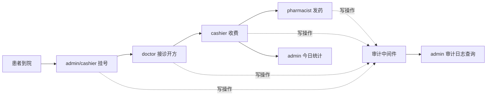

# 小型门诊医院信息管理系统 需求规格说明书

| 项目 | 内容 |
|---|---|
| 项目名称 | 小型门诊医院信息管理系统 |
| 文档名称 | 需求规格说明书 |
| 文档版本 | v1.0 |
| 编制日期 | 2026-10-27 |
| 编制依据 | 《医院信息系统功能规范（2002版）》、本项目 AGENTS.md、docs/功能点清单.md、backend/ 与 frontend/ 现有代码 |
| 适用范围 | 小型门诊挂号、医生接诊开方、收费、药房发药、统计与审计课程设计 |

---

## 1. 项目概述

### 1.1 项目背景

本项目面向小型门诊场景，参考《医院信息系统功能规范（2002版）》中门诊挂号、门诊医生工作站、门诊收费、药房管理、统计报表和系统管理相关要求，实现一套覆盖门诊核心业务链路的课程设计系统。

系统以“患者挂号 → 医生接诊开方 → 收费 → 药房发药”为主线，重点体现医疗业务中的数据一致性、权限隔离、金额安全和操作可追溯。

### 1.2 建设目标

1. 实现门诊挂号、号源管理和患者挂号记录管理。
2. 实现医生工作站，支持待接诊患者查看、ICD-10 诊断和处方开立。
3. 实现处方后端划价、收费单生成和处方已收费状态更新。
4. 实现药品档案、CSV 批量导入、库存扣减和发药管理。
5. 实现 RBAC 角色权限控制和全局审计日志。
6. 实现今日挂号量与今日收费金额统计。
7. 提供 Vue3 前端页面和 Docker Compose 部署方案。

### 1.3 系统范围

系统覆盖以下业务子系统：

- 系统管理与登录认证
- 门诊挂号
- 门诊医生工作站
- 门诊收费
- 药房药品与发药管理
- 统计报表
- 全局审计日志

系统不包含住院管理、医保结算、电子病历文书、检验检查、外部接口、短信通知和正式财务对账等扩展功能。

### 1.4 技术架构

| 层次 | 技术选型 |
|---|---|
| 后端 | FastAPI + SQLAlchemy ORM |
| 数据库 | SQLite，开发与课程部署使用单机文件数据库 |
| 前端 | Vue3 + Vite |
| 鉴权 | JWT + RBAC |
| 测试 | pytest 单元测试与 API 测试 |
| 部署 | Docker Compose、Nginx 反向代理 |
| 数据持久化 | Docker volume 挂载 SQLite 数据目录 |

### 1.5 总体业务链路

---

## 2. 角色说明

### 2.1 角色定义

| 角色代码 | 角色名称 | 主要职责 |
|---|---|---|
| admin | 系统管理员 | 排班维护、药品档案维护、CSV 导入、审计查询、统计查看、挂号操作 |
| doctor | 门诊医生 | 查看本人待接诊患者、开具处方 |
| cashier | 收费员 | 挂号操作、查询未收费处方、执行收费、查询收费记录 |
| pharmacist | 药房药师 | 药品档案查看、CSV 药品导入、已收费处方发药 |

### 2.2 角色权限矩阵

| 功能 | admin | doctor | cashier | pharmacist |
|---|---|---|---|---|
| 登录、查看当前用户 | 允许 | 允许 | 允许 | 允许 |
| 查询可用排班号源 | 允许 | 允许 | 允许 | 允许 |
| 新增/修改/删除排班 | 允许 | 禁止 | 禁止 | 禁止 |
| 创建挂号记录 | 允许 | 禁止 | 允许 | 禁止 |
| 查询挂号记录 | 允许 | 允许 | 允许 | 允许 |
| 查看本人待接诊患者 | 禁止 | 允许 | 禁止 | 禁止 |
| 创建处方 | 禁止 | 允许 | 禁止 | 禁止 |
| 查询处方列表 | 禁止 | 禁止 | 允许 | 允许 |
| 收费预览、执行收费 | 禁止 | 禁止 | 允许 | 禁止 |
| 查询收费记录 | 禁止 | 禁止 | 允许 | 禁止 |
| 新增/修改/删除药品 | 允许 | 禁止 | 禁止 | 禁止 |
| CSV 导入药品 | 允许 | 禁止 | 禁止 | 允许 |
| 查询药品档案 | 允许 | 允许 | 允许 | 允许 |
| 执行发药 | 禁止 | 禁止 | 禁止 | 允许 |
| 查询审计日志 | 允许 | 禁止 | 禁止 | 禁止 |
| 查询今日统计 | 允许 | 禁止 | 禁止 | 禁止 |

### 2.3 前端角色导航

| 角色 | 可见导航 |
|---|---|
| admin | 排班管理、审计日志、统计报表、门诊挂号 |
| doctor | 医生工作站 |
| cashier | 收费工作台、门诊挂号 |
| pharmacist | 药房工作台 |

说明：挂号入口仅对 admin 和 cashier 展示；doctor 和 pharmacist 不显示挂号入口。后端同时做强制权限校验。

---

## 3. 业务流程

### 3.1 登录与鉴权流程

1. 用户提交用户名和密码。
2. 后端校验 bcrypt 密码哈希。
3. 校验成功后签发 JWT，token 携带用户 ID、角色和过期时间。
4. 前端保存 token，并在后续请求中携带 `Authorization: Bearer <token>`。
5. 未登录访问受保护接口返回 `401`；角色不匹配返回 `403`。

### 3.2 排班管理流程

1. admin 进入排班管理页面。
2. 查询医生列表并选择医生。
3. 填写科室、排班日期和最大号源数量。
4. 系统校验医生角色、日期、号源数量和重复排班。
5. 新增排班时，剩余号源自动初始化为最大号源。
6. 修改最大号源时，新值不得小于已使用号源。
7. 已产生挂号记录的排班不得删除。
8. 排班新增、修改、删除均自动写入审计日志。

### 3.3 挂号流程

1. admin 或 cashier 进入挂号页面。
2. 按日期和科室查询可用排班；医生和药师也可查询号源用于只读查看。
3. 选择排班，录入患者姓名和手机号。
4. 后端在同一个数据库事务中完成号源扣减和挂号记录创建。
5. 号源为 0 时拒绝挂号并返回业务错误。
6. 挂号成功后，挂号记录进入医生待接诊范围。
7. 挂号 POST 请求自动写入审计日志。

### 3.4 医生接诊与开方流程

1. doctor 登录后进入医生工作站。
2. 系统仅展示当前医生名下、状态为已挂号且尚未创建处方的患者。
3. 医生选择患者，填写 ICD-10 编码和诊断名称。
4. 医生选择药品并填写数量。
5. 后端校验 ICD-10 格式、诊断名称、药品明细和数量。
6. 后端校验该挂号是否属于当前医生。
7. 处方主表与明细在同一事务中提交。
8. 一个挂号只能创建一张处方。
9. 处方创建成功后，该患者从待接诊列表移除。
10. 处方创建请求自动写入审计日志。

### 3.5 收费流程

1. cashier 进入收费工作台。
2. 查询未收费处方列表。
3. 选择处方，调用收费预览接口。
4. 后端读取药品档案单价，按明细数量计算应收金额。
5. 前端不得提交价格参与计算；即使提交也会被忽略。
6. 收费接口在同一个事务中：
   - 生成收费单 ChargeOrder；
   - 将处方 `paid` 标记为 `True`。
7. 已收费处方再次收费返回冲突错误。
8. 收费请求自动写入审计日志。

### 3.6 发药流程

1. pharmacist 进入药房工作台。
2. 查询已收费处方，系统展示药品明细和当前库存。
3. 未收费处方不得发药。
4. 选择待发药处方并确认发药。
5. 后端在同一个事务中：
   - 按处方明细扣减药品库存；
   - 生成发药记录 DispenseRecord。
6. 任意药品库存不足时，整个事务回滚，返回库存不足错误。
7. 已发药处方不得重复发药。
8. 发药请求自动写入审计日志。

### 3.7 药品与 CSV 导入流程

1. admin 或 pharmacist 上传 CSV 文件。
2. 后端校验表头和逐行数据。
3. 缺少必填项、非法数值、重复药品的行标记为错误行。
4. 合法行正常入库，错误行不阻断合法行。
5. 返回成功数量、失败数量和逐行错误明细。
6. 导入完成后刷新药品档案列表。

### 3.8 统计与审计流程

1. admin 查看今日统计报表。
2. 系统返回今日挂号总数量和今日收费总金额。
3. 所有 POST、PUT、PATCH、DELETE 写请求由审计中间件自动记录。
4. admin 可按操作人、时间、请求方法和请求路径查询审计日志。
5. 审计载荷中的密码、token、secret 等敏感字段自动脱敏。

---

## 4. 功能需求

### 4.1 功能需求汇总

| 编号 | 功能模块 | 需求描述 | 优先级 | 当前状态 |
|---|---|---|---|---|
| FR-01 | 登录认证 | 用户名密码登录、JWT 鉴权、当前用户查询 | 必做 | 已实现 |
| FR-02 | 角色权限 | 四类角色 RBAC 权限隔离 | 必做 | 已实现 |
| FR-03 | 排班管理 | 管理员维护医生排班和号源 | 必做 | 已实现 |
| FR-04 | 门诊挂号 | 查询号源、创建挂号、事务扣减号源、挂号记录查询 | 必做 | 已实现 |
| FR-05 | 医生工作站 | 待接诊列表、处方主表与明细、ICD-10 诊断 | 必做 | 已实现 |
| FR-06 | 门诊收费 | 后端划价、收费单、处方 paid 状态、收费记录 | 必做 | 已实现 |
| FR-07 | 药品档案 | 药品五要素、单价、库存、CRUD、CSV 导入 | 必做 | 已实现 |
| FR-08 | 药房发药 | 已收费处方发药、库存扣减、事务回滚 | 必做 | 已实现 |
| FR-09 | 统计报表 | 今日挂号量、今日收费金额 | 必做 | 已实现 |
| FR-10 | 审计日志 | 全局写操作审计、脱敏、管理员查询 | 必做 | 已实现 |
| FR-11 | 前端页面 | 登录、排班、挂号、医生、收费、药房、审计、统计页面 | 必做 | 已实现 |
| FR-12 | 用户管理 | 用户账号维护和密码管理 | 扩展 | 服务层/初始化脚本支持，未开放独立页面 |
| FR-13 | 数据备份 | 定时备份数据库 | 选做 | 暂不实现 |
| FR-14 | 自动化 E2E | Playwright 主流程测试 | 选做 | 暂未实现 |

### 4.2 登录认证与系统管理

#### FR-01 登录认证

- 系统应提供用户名密码登录。
- 密码必须使用 bcrypt 加盐哈希存储，不得保存明文密码。
- 登录成功后签发 JWT，token 应包含用户 ID、角色和过期时间。
- 系统应提供当前登录用户查询接口。
- 未认证访问受保护接口应返回 `401`。
- 登录写操作应自动进入审计日志，密码字段应脱敏。

#### FR-02 角色权限

- 系统应支持 admin、doctor、cashier、pharmacist 四类角色。
- 接口应根据角色进行鉴权，越权访问返回 `403`。
- 前端导航应按角色显示对应功能入口。
- 后端权限校验为最终依据，不能仅依赖前端隐藏入口。

#### FR-12 用户账号管理

- 系统应支持创建四类测试账号并分配角色。
- 当前版本通过 `scripts/init_user.py` 初始化账号，服务层提供用户创建和密码重置能力。
- 当前版本未提供独立用户管理页面和完整用户 CRUD API，作为后续扩展需求。

### 4.3 门诊挂号

#### FR-03 排班管理

- admin 应能新增排班，字段包括科室、医生、排班日期、最大号源。
- 排班只能分配给 doctor 角色账号。
- 同一医生、同一科室、同一日期不得重复排班。
- 新增排班时，剩余号源应等于最大号源。
- admin 应能修改排班；修改最大号源时不得低于已使用号源。
- admin 应能删除未被挂号记录引用的排班。
- 已产生挂号记录的排班删除应返回冲突错误。
- doctor、cashier、pharmacist 不得维护排班。

#### FR-04 门诊挂号

- 登录用户应能按日期和科室查询有剩余号源的排班。
- admin 和 cashier 应能创建挂号记录。
- doctor 和 pharmacist 创建挂号应返回 `403`。
- 挂号记录应包含患者姓名、手机号、排班 ID、挂号状态和创建时间。
- 挂号必须在数据库事务中完成号源扣减和记录创建。
- 号源为 0 时应拒绝挂号。
- 号源不得为负数。
- 登录用户应能查询挂号记录。
- 挂号成功后应能在收费、医生工作站等后续环节查询到该记录。

### 4.4 门诊医生工作站

#### FR-05 医生工作站与处方

- doctor 应能查询本人名下待接诊患者。
- 待接诊条件：挂号状态为已挂号、排班医生为当前医生、该挂号尚未创建处方。
- 医生应能创建处方主表，记录挂号 ID、医生 ID、ICD-10 编码、诊断名称和收费状态。
- 处方必须保存 ICD-10 编码和诊断中文名称。
- ICD-10 编码格式应校验，例如 `J06.9`。
- 医生应能批量添加处方明细，记录药品 ID 和数量。
- 处方明细数量必须大于 0。
- 同一处方内不得出现重复药品。
- 医生只能为本人排班下的挂号开方。
- 一个挂号只能创建一张处方。
- 处方主表与明细应在同一事务中提交。
- 处方创建成功后，该挂号不再出现在待接诊列表。
- 只有 doctor 角色可以创建处方。

### 4.5 门诊收费

#### FR-06 收费

- cashier 应能查询未收费处方列表。
- cashier 应能查看处方明细和收费预览。
- 应收金额必须由后端读取药品档案单价并乘以明细数量计算。
- 前端传入的任何价格、金额字段不得参与计算。
- 收费接口应在同一个数据库事务中完成：
  1. 生成收费单 ChargeOrder；
  2. 将处方 `paid` 更新为 `True`。
- 只有 `paid=False` 的处方允许收费。
- 已收费处方再次收费应返回冲突错误，不得生成第二张收费单。
- 收费单应记录处方 ID、总金额、收费员 ID 和收费时间。
- cashier 应能查询收费记录。
- 处方包含未维护药品或非法明细时，收费应失败且不改变处方状态。

### 4.6 药品档案与药房发药

#### FR-07 药品档案

- 药品档案必须包含：
  - 通用名；
  - 商品名；
  - 规格；
  - 剂型；
  - 医保类别；
  - 单价；
  - 库存。
- 数据库应约束库存不得小于 0。
- 数据库应约束单价不得小于 0。
- admin 应能新增、修改、删除药品。
- 登录用户应能查询药品列表。
- 已被处方明细引用的药品不得删除。
- admin 和 pharmacist 应能通过 CSV 批量导入药品。
- CSV 应支持 UTF-8 / GB18030 编码，兼容中英文表头。
- CSV 应逐行校验，缺少必填项或非法数值的行标记为错误行。
- 错误行不得影响合法行入库。
- 导入结果应返回成功数量、失败数量和错误明细。

#### FR-08 发药

- pharmacist 应能查询已收费处方。
- 未收费处方不得发药。
- 发药接口应校验处方 `paid=True`。
- 发药应遍历处方明细扣减对应药品库存。
- 库存扣减必须使用库存大于等于需求数量的条件，防止库存负数。
- 任意药品库存不足时，整个发药事务回滚。
- 发药应生成发药记录，记录处方 ID、药师 ID 和发药时间。
- 同一处方不得重复发药。
- 只有 pharmacist 角色可以执行发药。

### 4.7 统计报表

#### FR-09 今日统计

- admin 应能查询今日挂号总数量和今日收费总金额。
- 统计口径为服务器本地日期当天 `00:00:00` 至次日 `00:00:00`。
- 挂号数量统计今日创建的挂号记录。
- 收费金额统计今日创建的收费单金额合计。
- 无数据时应返回 0。
- 金额保留 2 位小数。

### 4.8 审计日志

#### FR-10 全局审计

- 系统应通过全局中间件自动记录写请求。
- 拦截方法包括 POST、PUT、PATCH、DELETE。
- 审计记录应包含：
  - 操作人用户 ID；
  - 操作时间；
  - 请求路径；
  - 请求方法；
  - 响应状态码；
  - 简要业务载荷。
- 必须覆盖登录、挂号、开处方、收费、发药等关键操作。
- 业务代码不得手动调用写审计日志。
- 密码、token、secret 等敏感字段应脱敏。
- 审计载荷应限制长度，避免存储超大请求体。
- admin 应能按操作人、时间、请求方法、请求路径查询审计日志。
- 当前版本不提供审计日志修改和删除接口，保证审计记录可追溯。

### 4.9 前端页面

#### FR-11 页面要求

| 页面 | 可见角色 | 主要功能 |
|---|---|---|
| 登录页 | 所有人 | 登录、登录态恢复、退出 |
| 排班管理 | admin | 排班查询、新增、编辑、删除 |
| 门诊挂号 | admin、cashier | 查询号源、患者挂号、挂号记录 |
| 医生工作站 | doctor | 待接诊列表、处方开立、药品选择 |
| 收费工作台 | cashier | 未收费处方、收费预览、执行收费、收费记录 |
| 药房工作台 | pharmacist | 药品档案、CSV 导入、已收费处方发药 |
| 审计日志 | admin | 审计筛选、列表、载荷查看 |
| 统计报表 | admin | 今日挂号量、今日收费金额 |

---

## 5. 非功能需求

### 5.1 安全需求

| 编号 | 安全要求 |
|---|---|
| NFR-SEC-01 | 用户密码必须使用 bcrypt 加盐哈希存储，禁止明文存储和明文日志输出 |
| NFR-SEC-02 | 所有受保护接口必须校验 JWT，未登录返回 `401` |
| NFR-SEC-03 | 所有业务接口必须按角色鉴权，越权返回 `403` |
| NFR-SEC-04 | JWT 密钥、数据库地址、CORS 白名单等敏感配置必须从环境变量读取 |
| NFR-SEC-05 | 禁止将 `.env`、数据库文件、密钥打入前端构建产物或镜像 |
| NFR-SEC-06 | CORS 不得配置为 `allow_origins=["*"]`，允许来源必须由环境变量配置 |
| NFR-SEC-07 | 处方收费金额必须由后端读取药品档案单价计算，不信任前端价格参数 |
| NFR-SEC-08 | 用药、收费、发药等关键写操作必须使用数据库事务保证一致性 |
| NFR-SEC-09 | 数据库必须通过约束防止库存为负、号源为负和非法数量 |
| NFR-SEC-10 | 用户输入必须经过 Pydantic 校验，包括手机号、ICD-10、数量、金额和文件导入行 |

### 5.2 可追溯审计需求

| 编号 | 审计要求 |
|---|---|
| NFR-AUD-01 | 审计日志由全局中间件自动写入，业务代码不得手动写日志 |
| NFR-AUD-02 | 审计日志应记录操作人、操作时间、请求路径、请求方法、状态码和载荷摘要 |
| NFR-AUD-03 | 登录、挂号、开处方、收费、发药必须产生审计记录 |
| NFR-AUD-04 | 审计载荷中的 password、token、secret 等字段必须脱敏为 `***` |
| NFR-AUD-05 | 审计日志只能由 admin 查询 |
| NFR-AUD-06 | 审计日志当前不提供修改、删除接口，保持追加写入和可追溯性 |
| NFR-AUD-07 | 审计写入使用独立数据库会话，审计失败不应影响正常业务响应 |

### 5.3 数据一致性与完整性

| 编号 | 要求 |
|---|---|
| NFR-DATA-01 | 挂号扣减号源、创建挂号记录必须在同一事务中完成 |
| NFR-DATA-02 | 收费单创建和处方 `paid=True` 必须在同一事务中完成 |
| NFR-DATA-03 | 发药库存扣减和发药记录创建必须在同一事务中完成 |
| NFR-DATA-04 | 号源、库存、处方数量等关键字段应设置数据库约束和业务层双重校验 |
| NFR-DATA-05 | 一个挂号只能创建一张处方 |
| NFR-DATA-06 | 一个处方只能生成一张收费单 |
| NFR-DATA-07 | 一个处方只能发药一次 |
| NFR-DATA-08 | 同一医生、同一科室、同一日期不得重复排班 |

### 5.4 性能与容量

| 编号 | 要求 |
|---|---|
| NFR-PERF-01 | 系统面向小型门诊和课程演示规模，采用单机 SQLite 数据库 |
| NFR-PERF-02 | 常规列表查询和写操作应在可接受时间内返回，满足课堂演示 |
| NFR-PERF-03 | 药品导入应逐行处理，单次文件大小建议不超过 5 MB |
| NFR-PERF-04 | 当前版本未进行高并发压力测试，不作为生产级高并发系统使用 |

### 5.5 可用性与易用性

| 编号 | 要求 |
|---|---|
| NFR-UX-01 | 前端使用中文界面，按角色展示导航入口 |
| NFR-UX-02 | 关键操作应提供加载中、成功、失败和空数据提示 |
| NFR-UX-03 | 越权、登录过期、库存不足、号源耗尽等异常应给出明确提示 |
| NFR-UX-04 | 页面应支持常见桌面浏览器，并具备基本移动端适配 |
| NFR-UX-05 | 药品 CSV 导入应展示成功数量、失败数量和逐行错误原因 |

### 5.6 可维护性与可测试性

| 编号 | 要求 |
|---|---|
| NFR-MNT-01 | 后端采用 models、schemas、services、routers 分层结构 |
| NFR-MNT-02 | 核心业务逻辑应放在 services 层，路由层保持轻薄 |
| NFR-MNT-03 | 应提供 pytest 单元测试和 API 测试 |
| NFR-MNT-04 | 当前后端测试全部通过，前端应能通过生产构建 |
| NFR-MNT-05 | 数据表字段变更应提供迁移脚本，不允许删库重建 |
| NFR-MNT-06 | 前端构建产物和后端依赖应可通过 Docker Compose 部署 |

### 5.7 部署与运行环境

| 编号 | 要求 |
|---|---|
| NFR-DEP-01 | 后端使用 Python 3.11 镜像运行 |
| NFR-DEP-02 | 前端使用 Node 20 构建，使用 Nginx 托管静态文件 |
| NFR-DEP-03 | Nginx 将 `/api` 反向代理到 `http://backend:8000` |
| NFR-DEP-04 | 后端 8000 端口不直接暴露到宿主机，只通过前端 Nginx 访问 |
| NFR-DEP-05 | 前端宿主机端口为 8080，映射到容器 80 |
| NFR-DEP-06 | SQLite 数据库通过 `./data:/data` 持久化 |
| NFR-DEP-07 | `.env` 通过 Docker Compose `env_file` 注入，不进入镜像 |
| NFR-DEP-08 | 后端容器应先于前端启动，前端通过 `depends_on` 依赖后端 |

---

## 6. 数据需求

### 6.1 核心数据对象

| 数据对象 | 说明 | 关键字段 |
|---|---|---|
| User | 系统用户 | id、username、password_hash、role |
| Schedule | 医生排班 | department、doctor_id、schedule_date、max_quota、remaining_quota |
| Registration | 挂号记录 | patient_name、phone、schedule_id、status、created_at |
| Prescription | 处方主表 | registration_id、doctor_id、icd10_code、diagnosis_name、paid |
| PrescriptionItem | 处方明细 | prescription_id、drug_id、qty |
| Drug | 药品档案 | generic_name、trade_name、spec、dosage_form、insurance_type、unit_price、stock |
| ChargeOrder | 收费单 | prescription_id、total_amount、cashier_id、charged_at |
| DispenseRecord | 发药记录 | prescription_id、pharmacist_id、dispensed_at |
| AuditLog | 审计日志 | operator_user_id、operate_time、request_path、method、payload、status_code |

### 6.2 关键数据约束

1. 用户密码只保存 bcrypt 哈希。
2. 排班剩余号源不得小于 0，且不得超过最大号源。
3. 挂号号源扣减必须事务化。
4. 一个挂号只能有一张处方。
5. 处方明细数量必须大于 0，同一处方内药品不得重复。
6. 一个处方只能有一张收费单。
7. 收费金额必须由药品档案单价计算。
8. 药品库存不得小于 0。
9. 一个处方只能有一条发药记录。
10. 审计日志追加写入，不提供业务修改入口。

---

## 7. 接口需求摘要

| 方法 | 路径 | 权限 | 说明 |
|---|---|---|---|
| POST | `/api/auth/login` | 公开 | 登录并获取 JWT |
| GET | `/api/me` | 登录用户 | 查询当前用户 |
| GET | `/api/schedules` | admin | 查询排班列表 |
| POST | `/api/schedules` | admin | 新增排班 |
| PUT | `/api/schedules/{id}` | admin | 修改排班 |
| DELETE | `/api/schedules/{id}` | admin | 删除排班 |
| GET | `/api/schedules/available` | 登录用户 | 查询指定日期、科室可用号源 |
| GET | `/api/doctors` | admin | 查询医生列表 |
| GET | `/api/registrations` | 登录用户 | 查询挂号记录 |
| POST | `/api/registrations` | admin、cashier | 创建挂号并扣减号源 |
| GET | `/api/doctor/pending-registrations` | doctor | 查询当前医生待接诊患者 |
| GET | `/api/prescriptions` | cashier、pharmacist | 查询处方列表 |
| POST | `/api/prescriptions` | doctor | 创建处方及明细 |
| GET | `/api/prescriptions/{id}/charge-preview` | cashier | 查询处方收费预览 |
| GET | `/api/charge-orders` | cashier | 查询收费记录 |
| POST | `/api/charge-orders` | cashier | 执行收费 |
| GET | `/api/drugs` | 登录用户 | 查询药品档案 |
| POST | `/api/drugs` | admin | 新增药品 |
| PUT | `/api/drugs/{id}` | admin | 修改药品 |
| DELETE | `/api/drugs/{id}` | admin | 删除药品 |
| POST | `/api/drugs/import` | admin、pharmacist | CSV 批量导入药品 |
| POST | `/api/dispenses` | pharmacist | 对已收费处方发药 |
| GET | `/api/statistics/today` | admin | 查询今日挂号量和收费金额 |
| GET | `/api/audit-logs` | admin | 查询审计日志 |

---

## 8. 约束、假设与范围外

### 8.1 约束

1. 系统面向单家小型门诊，不涉及多院区、多租户。
2. 数据库采用 SQLite，适合课程设计和轻量部署。
3. 系统不接入医保、检验、影像、电子病历等外部系统。
4. 审计日志只追加，不提供业务修改和删除接口。
5. 当前版本不实现数据定时备份和正式财务对账。
6. 当前版本未实现完整的用户管理页面，账号通过初始化脚本和服务层维护。
7. 当前版本未实现处方退费、挂号取消退号、库存盘点和药品批次管理。

### 8.2 假设

1. 用户通过浏览器访问系统。
2. 系统部署在可信内网或本地课程环境。
3. 生产环境如需公网部署，应额外配置 HTTPS、反向代理安全策略和数据库备份。
4. 药品单价和库存由药品档案维护人员负责录入。
5. 收费员和药房药师按实际业务流程操作系统。

### 8.3 范围外功能

- 住院管理
- 医保结算
- 检验检查
- 电子病历文书
- 短信通知
- 微信公众号/小程序
- 高并发集群部署
- 数据定时备份与灾备
- 处方退费与退号
- 药品批次、效期和盘点管理

---

## 9. 验收要点

| 编号 | 验收场景 | 预期结果 |
|---|---|---|
| AC-01 | doctor 直接调用挂号 POST | 返回 `403` |
| AC-02 | pharmacist 登录查看导航 | 不显示门诊挂号入口 |
| AC-03 | cashier 正常挂号 | 返回 `201`，号源减 1 |
| AC-04 | admin 正常挂号 | 返回 `201`，号源减 1 |
| AC-05 | 号源为 0 时再次挂号 | 返回业务错误，号源保持 0 |
| AC-06 | doctor 创建处方 | 处方主表和明细成功写入，患者从待接诊列表移除 |
| AC-07 | cashier 收费时传入伪造价格 | 后端仍按药品档案单价计算 |
| AC-08 | 已收费处方再次收费 | 返回冲突错误，不生成第二张收费单 |
| AC-09 | 未收费处方发药 | 返回错误，库存不变 |
| AC-10 | 库存不足时发药 | 返回错误，所有库存回滚，不生成发药记录 |
| AC-11 | 已发药处方再次发药 | 返回冲突错误，库存不重复扣减 |
| AC-12 | CSV 导入包含错误行 | 合法行入库，错误行返回行号和原因 |
| AC-13 | 执行发药后查询审计日志 | 能查到药师操作人、路径、方法和状态 |
| AC-14 | admin 查询今日统计 | 返回今日挂号数量和收费金额 |
| AC-15 | 非 admin 查询审计或统计 | 返回 `403` |

---

## 10. 当前实现与验证概况

- 后端已实现登录、排班、挂号、医生工作站、处方、收费、药品、CSV 导入、发药、审计、统计等接口。
- 前端已实现登录、排班管理、门诊挂号、医生工作站、收费工作台、药房工作台、审计日志、统计报表页面。
- 后端 pytest 测试覆盖单元测试与 API 测试，当前全部通过。
- 前端已通过 Vite 生产构建。
- 已提供 Dockerfile、Nginx 配置和 docker-compose 部署配置。
- 尚未实现：数据定时备份、完整用户管理页面、Playwright E2E、处方退费、挂号取消退号、药品批次管理。

---

## 附录 A：与 2002 版医院信息系统功能规范的对应关系

| 2002 版规范相关领域 | 本项目对应模块 |
|---|---|
| 门诊挂号 | 排班管理、号源查询、挂号记录、号源事务扣减 |
| 门诊医生工作站 | 待接诊患者、ICD-10 诊断、处方主表与明细 |
| 门诊收费 | 后端划价、收费单、处方已收费状态、收费记录 |
| 药房管理 | 药品五要素档案、CSV 导入、发药、库存扣减 |
| 统计报表 | 今日挂号量、今日收费金额 |
| 系统管理 | 登录认证、RBAC 角色权限、全局审计日志 |

本需求规格说明书以课程设计实现范围为边界，未覆盖的功能在“范围外功能”中列明。
